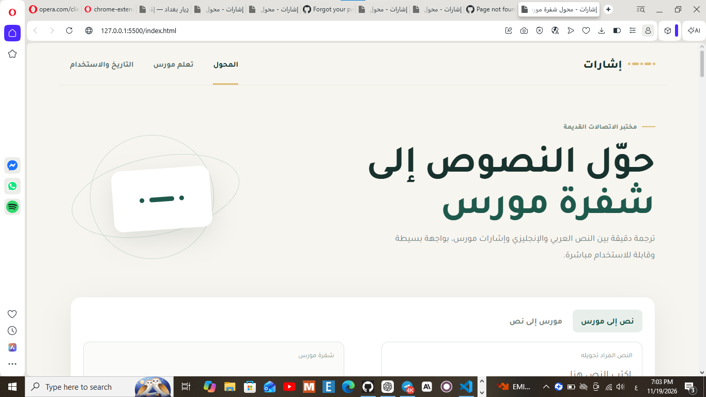

# Morse Code Converter | إشارات

A web-based Morse Code converter that allows users to translate text into Morse code and decode Morse code back into Arabic and English text.

**Live Demo:** [Visit Morse Code Converter](https://sajashaker21.github.io/morse_code/)

## 🌟 About The Project

إشارات is an interactive web application designed to make learning and using Morse code easier.

The application provides a simple interface for converting messages, listening to Morse code signals, exploring character references, and learning about the history of Morse code.

## ✨ Features

- **Text to Morse Code:** Convert Arabic and English text into Morse code.
- **Morse Code to Text:** Decode Morse code signals into readable text.
- **Audio Playback:** Listen to Morse code signals through audio playback.
- **Character Reference Table:** Explore Morse code symbols for Arabic and Latin characters.
- **Search Functionality:** Search for specific characters in the reference table.
- **Educational Content:** Learn about the history, development, and applications of Morse code.
- **SOS Signal:** Explore the famous international distress signal.

## 🛠️ Technologies Used

- HTML5
- CSS3
- JavaScript

## 🚀 Getting Started

To run this project locally:

1. Clone the repository:

   ```bash
   git clone https://github.com/sajashaker21/morse_code.git
   ```

2. Open the project folder.

3. Open `index.html` in your web browser.

## 📖 How To Use

1. Open the live application.
2. Choose between Text to Morse or Morse to Text.
3. Enter your text or Morse code.
4. Click the conversion button.
5. Play the audio to listen to the Morse code signals.

## 🎯 Project Purpose

This project was developed to combine practical web development with an educational application, making Morse code more accessible through an interactive digital experience.

## 🌐 Live Application

[https://sajashaker21.github.io/morse_code/](https://sajashaker21.github.io/morse_code/)

## screenshots

